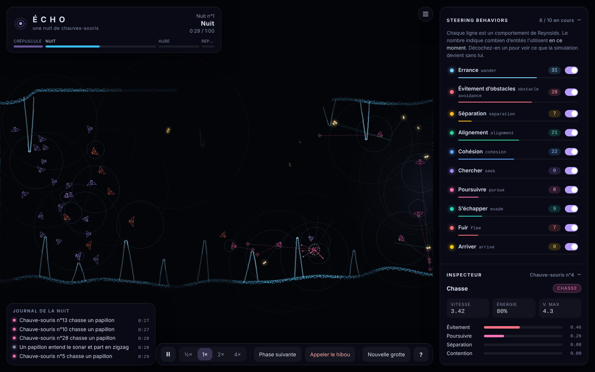
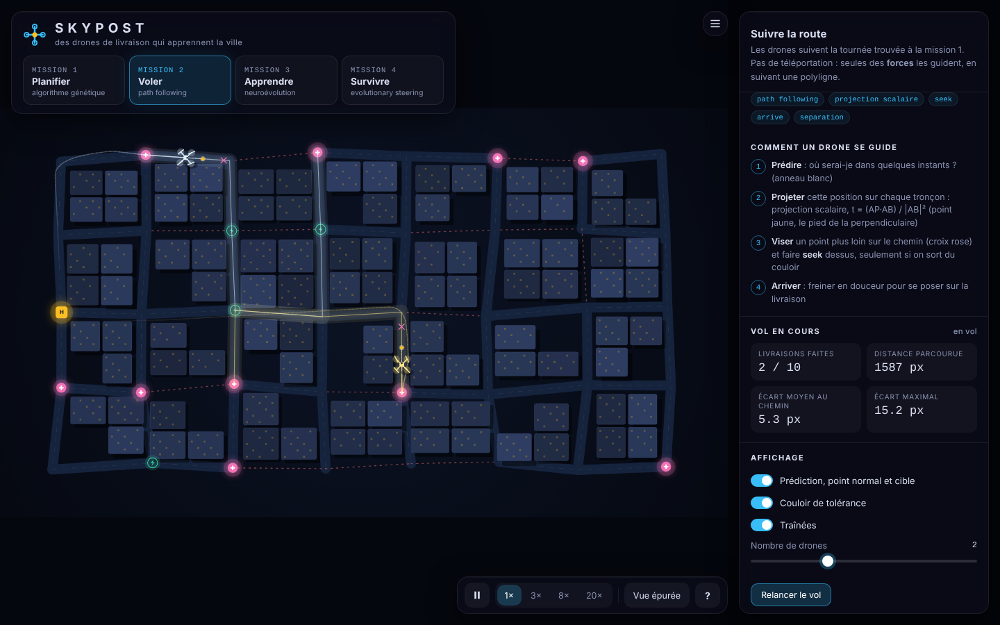
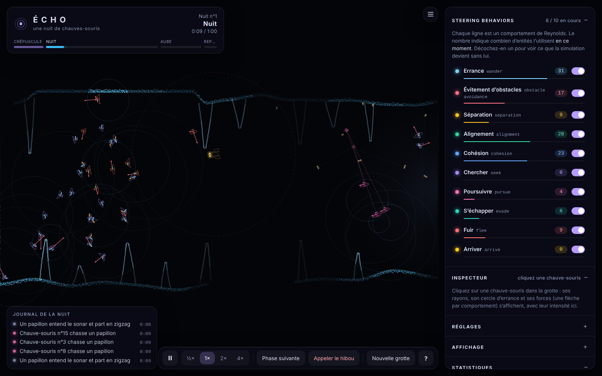
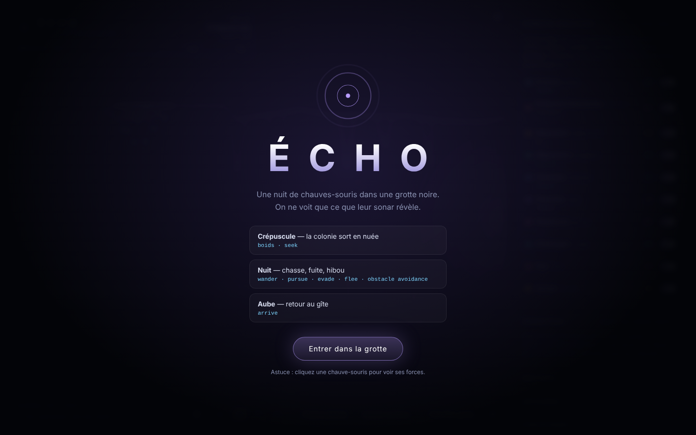
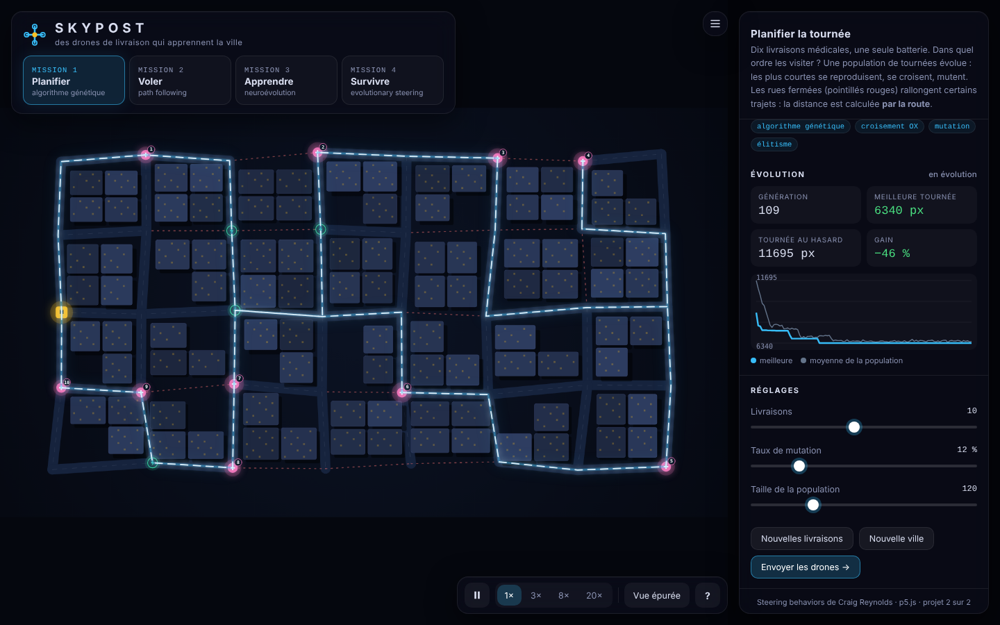
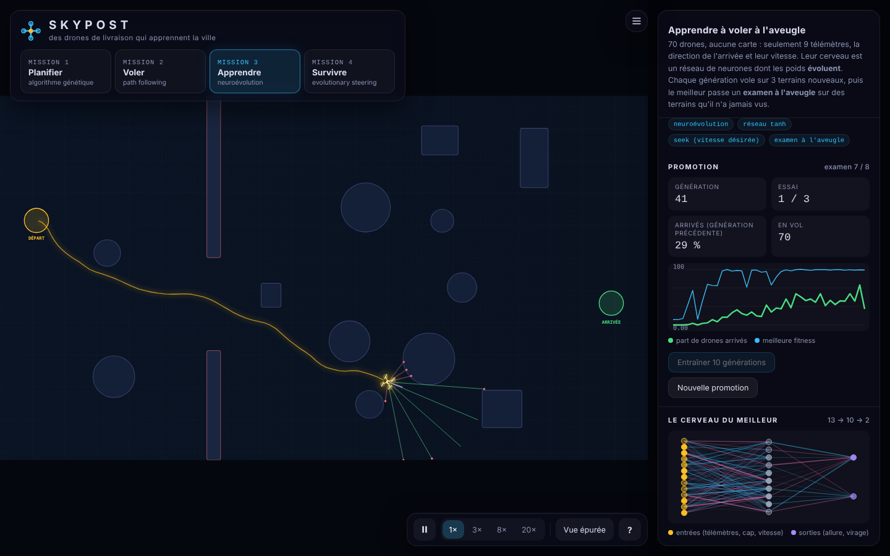
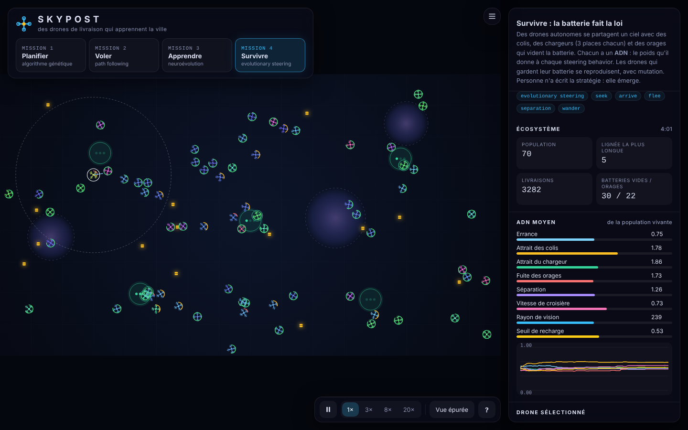
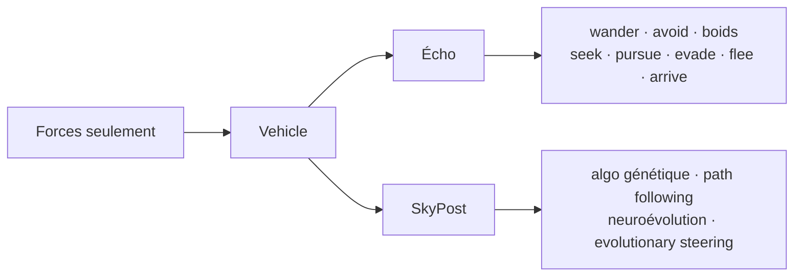

<div align="center">

# ✦ STEERING BEHAVIORS ✦

### Deux mondes. Quatorze comportements. Zéro téléportation.

*Des chauves-souris qui voient avec des échos, des drones qui apprennent une ville —<br>
tout est piloté par des **forces**, comme Craig Reynolds l'a imaginé.*

<br>


<br>

 

</div>

---

## Le principe en une phrase

> Une entité ne se déplace jamais directement : elle calcule une **force** `steering = vitesse désirée − vitesse actuelle`, la limite, l'applique, et c'est la physique qui décide.

Tout le dépôt obéit à cette règle. Les comportements sont des fonctions qui **renvoient** un vecteur ; seule `applyForce()` modifie l'accélération.

---

## ◐ Projet 1 — ÉCHO

**Une nuit de chauves-souris dans une grotte noire.** On ne voit que ce que leur sonar révèle : chaque cri envoie une onde qui allume parois, papillons et hibou, puis tout s'éteint.

<table>
<tr>
<td width="50%"><br><sub><b>Le hibou entre.</b> Flee, evade, pursue et obstacle avoidance en même temps, avec les vecteurs de forces affichés.</sub></td>
<td width="50%"><br><sub><b>Écran d'accueil.</b> Crépuscule → Nuit → Aube : trois phases, une machine à états.</sub></td>
</tr>
</table>

| Comportement | Où on le voit |
|---|---|
| `wander` | Errance nocturne à direction continue |
| `obstacle avoidance` | 7 rayons de sonar, virage vers le plus dégagé |
| `separation` · `alignment` · `cohesion` | La nuée du crépuscule (boids) |
| `seek` | Suivre le chef de colonie, rejoindre le gîte |
| `pursue` | Viser où le papillon *sera* |
| `evade` | Le papillon fuit la position *future* de la chasseuse |
| `flee` | La colonie s'éparpille devant le hibou |
| `arrive` | Freiner et se suspendre au plafond à l'aube |

**Dans l'interface :** désactivez n'importe quel comportement en direct pour voir la simulation sans lui, cliquez une chauve-souris pour lire ses forces.

📖 [Documentation du projet 1](projet-1/README.md)

---

## ◑ Projet 2 — SKYPOST

**Des drones de livraison médicale qui apprennent une ville.** Quatre missions : une tournée *planifiée*, une route *suivie*, un pilotage *appris*, une stratégie *évoluée*.

<table>
<tr>
<td width="50%"><br><sub><b>1 · Planifier.</b> Un algorithme génétique cherche l'ordre des livraisons le plus court, par la route.</sub></td>
<td width="50%"><br><sub><b>2 · Voler.</b> Path following : position prédite, projection scalaire, cible.</sub></td>
</tr>
<tr>
<td width="50%"><br><sub><b>3 · Apprendre.</b> Un pilote neuronal sans carte passe son examen sur des terrains inconnus.</sub></td>
<td width="50%"><br><sub><b>4 · Survivre.</b> L'ADN pèse chaque comportement ; la batterie décide qui se reproduit.</sub></td>
</tr>
</table>

| Mission | Technique | Idée clé |
|---|---|---|
| 1 | Algorithme génétique | Croisement OX, mutation, élitisme ; fitness = 1 / distance par Dijkstra |
| 2 | Path following + projection scalaire | `t = (AP·AB) / \|AB\|²` ; seek sur un point plus loin du chemin |
| 3 | Neuroévolution + examen à l'aveugle | Le réseau choisit une vitesse désirée ; la force reste celle de Reynolds |
| 4 | Evolutionary steering | 8 gènes = poids de seek, arrive, flee, separation, wander… |

📖 [Documentation du projet 2](projet-2/README.md)

---

## ▶ Lancer

```bash
git clone https://github.com/Ilyass-Hakim/steering-behaviors-finals
cd steering-behaviors-finals/projet-1     # ou projet-2
python -m http.server 8080                # puis http://localhost:8080
npm test                                  # tests unitaires, aucune dépendance
```

Ou simplement ouvrir `index.html` dans un navigateur.

---

## ⌬ Vue d'ensemble



<details>
<summary><b>Arborescence</b></summary>

```
.
├── README.md          cette page
├── AGENTS.md          règles pour les agents (IA) qui modifient le dépôt
├── STRATEGIE.md       choix techniques et méthode de travail
├── docs/images/       captures de l'application
├── projet-1/          Écho   (92 tests)
└── projet-2/          SkyPost (43 tests)
```

</details>

<details>
<summary><b>Historique</b></summary>

Un commit par fonctionnalité, sur une branche dédiée fusionnée avec `--no-ff`. Le message nomme le steering behavior appliqué : `feat(wander): …`, `feat(obstacle-avoidance): …`, `fix(…): …`.

</details>

---

<div align="center">

<sub>Steering behaviors de Craig Reynolds · p5.js · conçu et développé avec Claude</sub>

</div>
