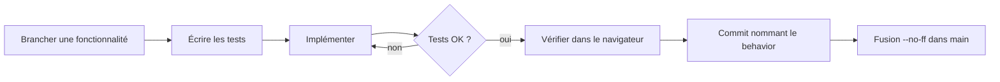

# STRATÉGIE — pourquoi ces deux projets, et comment ils ont été construits

## Objectif

Rassembler **tous les steering behaviors du cours** dans deux simulations qui se démarquent : lisibles pour un correcteur en 30 secondes, solides à l'examen du code, et agréables à regarder.

## Répartition

| | Écho | SkyPost |
|---|---|---|
| Nature des comportements | **Programmés**, combinés par poids | **Appris** ou **évolués** |
| Comportements | wander, obstacle avoidance, separation, alignment, cohesion, seek, pursue, evade, flee, arrive | algorithme génétique, path following, projection scalaire, neuroévolution, evolutionary steering |
| Pourquoi ce thème | Le sonar rend visibles les rayons d'évitement, les prédictions de pursue/evade et la fuite | Une ville est un graphe : chemins, distances et batteries donnent un vrai sens à chaque technique |

Le contraste est voulu : le projet 1 montre qu'on sait **écrire** un comportement, le projet 2 qu'on sait le **faire émerger**.

## Choix de conception

1. **Un seul contrat physique.** Tout passe par `steerVers(désiré)` : le réseau de neurones de SkyPost produit une vitesse désirée, pas une position. Les deux projets restent donc des steering behaviors au sens strict.
2. **Rendre les forces visibles.** Flèches par comportement, viseurs de pursue, cercle de wander, point normal du path following : l'interface explique le code.
3. **L'interface prouve la causalité.** Écho permet de désactiver chaque comportement en direct ; SkyPost affiche les courbes d'évolution et un brevet d'examen. Un correcteur voit l'effet de chaque idée.
4. **Déterminisme.** Graines fixes, simulation sans p5 : les tests peuvent affirmer qu'une population apprend (`l'examen est réussi plus souvent après N générations`).
5. **Zéro dépendance.** Cloner, ouvrir `index.html`, ça marche.

## Compromis assumés

- **Examen de neuroévolution** : la fitness est moyennée sur 3 terrains et le professeur utilise un champ de distance par les brèches. Sans cela, l'évolution se bloquait contre les murs. Le pilote, lui, reste aveugle.
- **Reproduction asexuée** en mission 4 : plus simple à lire, la sélection se voit directement dans l'ADN moyen.
- **Rues fermées** dans la ville : elles rendent la distance « par la route » indispensable et le travail de l'algorithme génétique visible.

## Méthode

- Une fonctionnalité à la fois, un commit par fonctionnalité, un `fix:` par problème résolu.
- Les captures d'écran servent de test visuel : sonar, viseurs, brevet, ADN.
- Les nombres magiques sont réglés par expérience (balayages de paramètres) puis fixés dans `config.js`.

## Risques et parades

| Risque | Parade |
|---|---|
| Simulation qui se fige (drones coincés) | Tests de collisions sur plusieurs graines, force de secours |
| Apprentissage instable | Moyenne sur plusieurs terrains, élitisme, mutation douce |
| Interface trop chargée | Panneau repliable, vue épurée, raccourcis clavier |
| Dépôt illisible | README illustré, `AGENTS.md`, un commit par idée |

## Pistes si le temps le permet

- Réseau récurrent (mémoire) pour contourner les murs sans les voir.
- Reproduction sexuée et lignées visibles en mission 4.
- Mode « comparaison » : deux colonies avec des paramètres d'environnement différents.
